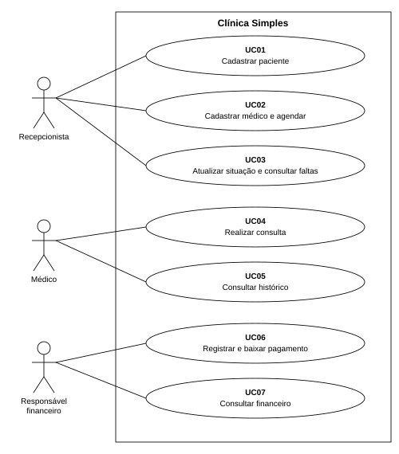
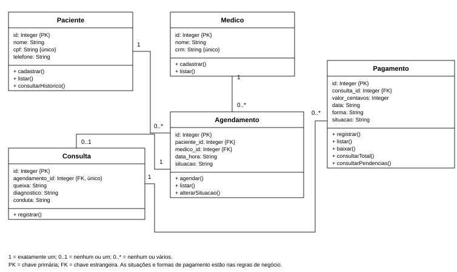

# Clínica Simples

## Análise e Projeto de Sistemas

Allan Vinicius Cabeggi Alvarenga — RGM: 45663742

Júlio César Benicio Inácio — RGM: 42693047

A Clínica Simples reúne o cadastro de pacientes e médicos, a agenda de atendimentos, as consultas e os pagamentos. O programa funciona no terminal, com JavaScript, Node.js e SQLite.

## 1 Método ágil Scrum

O trabalho está dividido em três sprints: cadastros e agenda; consultas e histórico; pagamentos. As tarefas ficam no backlog e passam pelas etapas A fazer, Em andamento e Concluído.

No início de cada sprint, a dupla escolhe as tarefas que serão desenvolvidas. O acompanhamento prevê conversas diárias de até dez minutos para tratar do andamento e das dificuldades. No encerramento, a revisão considera as funções concluídas e a retrospectiva define ajustes para a próxima etapa.

Uma tarefa está concluída quando a função atende ao requisito e sua documentação está atualizada. As datas das sprints indicam o planejamento do trabalho.

## 2 Squads e papéis

O projeto conta com um único squad, o Squad Clínica. Como a equipe tem dois integrantes, as responsabilidades de Scrum e desenvolvimento são divididas entre a dupla.

| Papel | Responsável | Responsabilidade |

| --- | --- | --- |

| Product Owner | Allan Vinicius Cabeggi Alvarenga | Definir a prioridade das tarefas e acompanhar os requisitos. |

| Scrum Master | Júlio César Benicio Inácio | Acompanhar as sprints e ajudar a resolver impedimentos. |

| Desenvolvimento | Allan Vinicius Cabeggi Alvarenga | Implementar o menu e as funções do programa. |

| Banco de dados | Júlio César Benicio Inácio | Organizar as tabelas, os relacionamentos e as consultas SQL. |

| Documentação | Ambos os integrantes | Organizar os requisitos, o backlog e os diagramas. |

## 3 Requisitos e regras de negócio

### 3.1 Requisitos funcionais

Os 15 requisitos funcionais descrevem as operações do sistema.

| Código | Função do sistema |

| --- | --- |

| RF01 | Cadastrar pacientes com nome, CPF e telefone, impedindo CPF duplicado. |

| RF02 | Listar os pacientes com seus códigos de identificação. |

| RF03 | Cadastrar médicos com nome e CRM e listar seus códigos. |

| RF04 | Criar agendamentos vinculados a um paciente e a um médico. |

| RF05 | Listar a agenda com paciente, médico, data, horário e situação. |

| RF06 | Confirmar um agendamento que esteja aberto. |

| RF07 | Cancelar um agendamento aberto e impedir que gere uma consulta. |

| RF08 | Registrar o não comparecimento e listar os pacientes que faltaram. |

| RF09 | Registrar queixa, diagnóstico e conduta da consulta e marcar o agendamento como Realizado. |

| RF10 | Consultar todas as consultas de um paciente, em ordem de data. |

| RF11 | Registrar um ou vários pagamentos vinculados a uma consulta. |

| RF12 | Listar pagamentos com código, consulta, valor, data, forma e situação. |

| RF13 | Dar baixa em um pagamento pendente, registrando o recebimento. |

| RF14 | Consultar o total recebido entre duas datas. |

| RF15 | Listar pacientes com pagamentos pendentes, telefone, valor e data prevista. |

O sistema se limita aos cadastros, à agenda, às consultas e aos pagamentos. O histórico é formado pelas consultas, sem prontuário separado. Não há login, integração bancária ou edição e exclusão geral dos cadastros. Especialidades, convênios, alergias, exames, medicamentos, prescrições, procedimentos, funcionários e múltiplas unidades ficam fora do escopo.

### 3.2 Requisitos não funcionais

| Código | Aspecto | Requisito |

| --- | --- | --- |

| RNF01 | Execução | Utilizar Node.js 22.13 ou superior, sem instalação de pacotes externos. |

| RNF02 | Armazenamento | Salvar os dados em um banco SQLite local e mantê-los após fechar o programa. |

| RNF03 | Interface | Usar um menu numerado no terminal, com mensagens de confirmação e de erro. |

| RNF04 | Integridade | Usar parâmetros nas consultas SQL, chaves estrangeiras e restrições para evitar registros duplicados ou sem vínculo. |

| RNF05 | Valores monetários | Armazenar os valores em centavos inteiros e recusar entradas fora do limite de inteiros seguros do JavaScript. |

| RNF06 | Organização | Concentrar as funções em main.js e a estrutura do banco em schema.sql. O package.json define o comando de execução. |

| RNF07 | Funcionamento local | Permitir o uso do programa sem conexão com a internet. |

### 3.3 Regras de negócio

| Código | Regra |

| --- | --- |

| RN01 | O CPF deve ter 11 dígitos, sem pontuação no armazenamento, e ser único. Não há cálculo dos dígitos verificadores. |

| RN02 | O CRM deve ser único e é convertido para letras maiúsculas. O sistema não valida o formato da UF nem consulta órgãos profissionais. |

| RN03 | Cada agendamento pertence a um paciente e a um médico existentes. Pacientes e médicos podem possuir vários agendamentos. |

| RN04 | Um médico não pode ter dois agendamentos no mesmo instante. Um cancelamento libera o horário. O controle compara horários de início, sem calcular a duração. |

| RN05 | As situações da agenda são Agendado, Confirmado, Realizado, Cancelado e Não compareceu. Agendamentos encerrados não são reabertos pelo menu. |

| RN06 | Somente agendamentos Agendados ou Confirmados podem gerar consulta. Cancelamentos, faltas e atendimentos já realizados impedem novo registro. |

| RN07 | Um agendamento gera no máximo uma consulta. Ela pertence ao paciente e ao médico da agenda; cada paciente e médico pode participar de várias consultas. |

| RN08 | Queixa, diagnóstico e conduta são obrigatórios. A consulta usa a data e o horário da agenda e, ao ser registrada, muda a situação para Realizado na mesma operação. |

| RN09 | Uma consulta pode ter nenhum, um ou vários pagamentos. Cada pagamento pertence a uma única consulta existente. |

| RN10 | O valor do pagamento deve ser positivo e ter até duas casas decimais na entrada. |

| RN11 | As formas de pagamento são dinheiro, cartão de crédito, cartão de débito e PIX. |

| RN12 | O pagamento fica Pendente ou Pago. A data é prevista enquanto pendente; a baixa registra Pago e a data atual do computador. Um pagamento pago não recebe nova baixa. |

| RN13 | O total por período soma somente pagamentos pagos, pela data de recebimento. As datas inicial e final são incluídas e o início não pode ser posterior ao fim. |

## 4 Sprints e requisitos de cada entrega

O quadro relaciona as datas previstas, as funções de cada sprint e os requisitos correspondentes.

| Sprint | Período previsto | Funções | Requisitos |

| --- | --- | --- | --- |

| 1 | 05/10/2026 a 11/10/2026 | Cadastros de pacientes e médicos, consulta de códigos, criação de agendamentos e listagem da agenda. | RF01, RF02, RF03, RF04, RF05 |

| 2 | 12/10/2026 a 18/10/2026 | Confirmação, cancelamento, faltas, registro das consultas e histórico do paciente. | RF06, RF07, RF08, RF09, RF10 |

| 3 | 19/10/2026 a 25/10/2026 | Registro, listagem e baixa dos pagamentos, total recebido por período e lista de pendências. | RF11, RF12, RF13, RF14, RF15 |

### Backlog das sprints

O backlog reúne as tarefas de cada sprint. As prioridades indicam a ordem de desenvolvimento.

| Item | Tarefa | Requisitos | Prioridade | Sprint |

| --- | --- | --- | --- | --- |

| PB01 | Cadastro e listagem de pacientes. | RF01, RF02 | Alta | 1 |

| PB02 | Cadastro de médicos e agenda de atendimentos. | RF03, RF04, RF05 | Alta | 1 |

| PB03 | Confirmação e cancelamento de agendamentos. | RF06, RF07 | Alta | 2 |

| PB04 | Registro das consultas. | RF09 | Alta | 2 |

| PB05 | Histórico do paciente. | RF10 | Alta | 2 |

| PB06 | Registro e consulta de faltas. | RF08 | Média | 2 |

| PB07 | Registro, consulta e baixa de pagamentos. | RF11, RF12, RF13 | Alta | 3 |

| PB08 | Total recebido por período e pendências. | RF14, RF15 | Alta | 3 |

## 5 Diagrama de casos de uso

A recepcionista cuida dos cadastros e da agenda. O médico registra as consultas e acompanha o histórico. O responsável financeiro registra os pagamentos e consulta os valores recebidos ou pendentes. Essas atividades usam o mesmo menu, sem login por perfil.

O paciente solicita o atendimento à recepção e não utiliza a aplicação diretamente.

## 6 Diagrama de classes do sistema

As cinco classes organizam os dados do sistema. Os atributos correspondem aos campos do banco, e as operações são executadas pelas funções de main.js.

1 = exatamente um; 0..1 = nenhum ou um; 0..* = nenhum ou vários. PK é chave primária e FK é chave estrangeira.

## Detalhamento dos casos de uso

### UC01 Cadastrar paciente

Ator: Recepcionista. Requisitos: RF01, RF02. Pré-condição: sistema aberto.

A recepção informa nome, CPF e telefone. O programa confere o formato e a duplicidade do CPF e salva o cadastro. A listagem permite consultar os pacientes e seus códigos.

Campos vazios, CPF fora do formato ou já cadastrado impedem o registro.

### UC02 Cadastrar médico e agendar

Ator: Recepcionista. Requisitos: RF03, RF04, RF05. Pré-condição: paciente cadastrado.

A recepção cadastra o médico com nome e CRM/UF. Com os códigos do paciente e do médico, informa a data e o horário da consulta. O agendamento é salvo com situação Agendado.

O registro é recusado quando o CRM já existe, algum código não corresponde a um cadastro, a data é inválida ou o médico já tem aquele horário ocupado.

### UC03 Atualizar situação e consultar faltas

Ator: Recepcionista. Requisitos: RF06, RF07, RF08. Pré-condição: agendamento existente e aberto.

A recepção consulta a agenda, informa o código do agendamento e escolhe confirmar, cancelar ou marcar falta. A lista de faltas mostra os agendamentos com situação Não compareceu.

Agendamentos encerrados não podem ser alterados. Um cancelamento ou uma falta impede o registro da consulta.

### UC04 Realizar consulta

Ator: Médico. Requisitos: RF09. Pré-condição: agendamento com situação Agendado ou Confirmado.

O médico informa o código de um agendamento aberto e registra queixa, diagnóstico e conduta. A consulta fica ligada ao paciente e ao médico da agenda, que passa para Realizado.

O registro é recusado se houver campo vazio ou se o agendamento não existir, estiver cancelado, tiver falta registrada ou já possuir consulta.

### UC05 Consultar histórico

Ator: Médico. Requisitos: RF10. Pré-condição: paciente cadastrado.

O médico informa o código do paciente. O histórico mostra suas consultas em ordem de data, com horário, profissional, queixa, diagnóstico e conduta.

Se não houver consultas, aparece a mensagem Nenhum registro encontrado. A consulta ao histórico não altera os dados.

### UC06 Registrar e baixar pagamento

Ator: Responsável financeiro. Requisitos: RF11, RF12, RF13. Pré-condição: consulta registrada.

O responsável financeiro informa o código da consulta, o valor, a data, a forma e a situação do pagamento. A listagem mostra os pagamentos cadastrados. A baixa muda um pagamento pendente para Pago e registra a data atual do computador.

Consulta inexistente, valor ou data inválidos impedem o cadastro. Pagamento inexistente ou já pago não recebe nova baixa.

### UC07 Consultar financeiro

Ator: Responsável financeiro. Requisitos: RF14, RF15. Pré-condição: sistema aberto.

O responsável financeiro informa um período para consultar o total recebido. A lista de pendências mostra paciente, telefone, código do pagamento, valor e data prevista.

Um período inválido gera erro. Sem recebimentos, o total é zero; sem pendências, a lista informa que nenhum registro foi encontrado.
